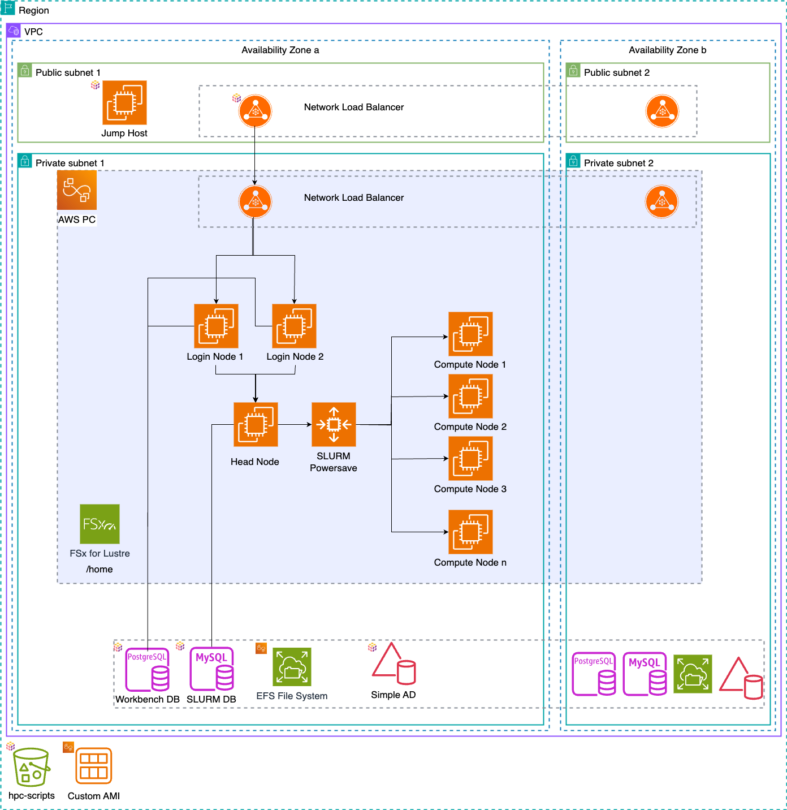

# Overview

{#fig-architecture}

AWS ParallelCluster builds the cluster itself (head node, login nodes, compute queues and their shared storage). Pulumi creates everything around it. As much as possible lives in private subnets; only the external load balancer is exposed to the internet.

| Component | Created by | Purpose |
|---|---|---|
| VPC with public/private subnets | pre-existing | Looked up by its `Name` tag (`vpc_name_tag`) |
| AWS SimpleAD | Pulumi | Users and groups for all nodes (via `sssd`) |
| AD jump host | Pulumi | Joined to SimpleAD, used to create users with `adcli` |
| PostgreSQL (`pwb`) | Pulumi | Workbench metadata, required for load balancing |
| PostgreSQL (`audit`) | Pulumi | Workbench audit database |
| MySQL | Pulumi | Slurm accounting (`slurmdbd`) |
| External and internal ALB | Pulumi | TLS termination (ACM certificate), sticky sessions to the login nodes |
| Route53 records | Pulumi | `<stack>-ext.<domain>` (external) and `<stack>.<domain>` (internal) |
| S3 bucket | Pulumi | Image build and cluster node scripts |
| Secrets Manager secrets | Pulumi | AD, Slurm DB and user passwords |
| Head node | ParallelCluster | `slurmctld`; writes the Workbench configuration |
| Login nodes (2) | ParallelCluster | `rstudio-server` and `rstudio-launcher` |
| Compute queues | ParallelCluster | `interactive`, `all`, `gpu`: Workbench sessions and jobs |
| EFS `/home`, `/opt/rstudio` | ParallelCluster | Home directories, shared Workbench config and data |

# Request flow

A user browses to the external ALB (`https://<stack>-ext.<domain>`). The ALB terminates TLS and forwards to port 8787 on one of the login nodes, using the `rs-csrf-token` cookie for stickiness. Workbench on the login node authenticates the user against SimpleAD (PAM/`sssd`) and starts sessions through the Slurm Launcher on the compute nodes. Inside the VPC, the internal ALB (`https://<stack>.<domain>`) serves the same login nodes. Sessions on the compute nodes use it to call back into Workbench (`launcher-sessions-callback-address`).

Each login node registers itself as an ALB target when it boots and deregisters itself when it shuts down. See @sec-lb-sync.

# Availability

The login nodes are managed by ParallelCluster: if one fails it is replaced, and the remaining node keeps serving users. Workbench state is in PostgreSQL and configuration is on EFS, so the Workbench part of the setup tolerates login node failures.

ParallelCluster supports [multi-AZ Slurm queues](https://aws.amazon.com/blogs/hpc/multiple-availability-zones-now-supported-in-aws-parallelcluster-3-4/), but this setup does not use them. The head node running `slurmctld` remains a single point of failure regardless. See [Reaching full HA](AWSParallelcluster.qmd#sec-full-ha) for ideas on how to remove it.

The RDS instances are created single-AZ and without deletion protection to keep demo environments cheap and easy to tear down. For production, enable Multi-AZ and deletion protection in `pulumi/__main__.py`.

# Keeping the load balancers in sync {#sec-lb-sync}

ParallelCluster replaces failed login nodes automatically, and the replacements get new IP addresses. To keep both the ALBs and Workbench's own node list correct, `parallelcluster/scripts/pwb-lb.sh` runs on every login node as the systemd unit `pwb-lb`:

-   **At boot** it registers the node's IP on port 8787 with both ALB target groups. It then cleans up:
    -   ALB targets whose IP doesn't belong to a running or pending login node of the cluster are deregistered.
    -   Workbench nodes (`rstudio-server list-nodes`) are deleted (`rserver-db delete-node`) if `node-status` reports them unreachable *and* EC2 has no running login node with their IP.
-   **At shutdown** it deregisters the node from both target groups and marks it offline in Workbench (`rserver-db stop-node`).

The cleanup works from EC2 data, not from Workbench's view alone. `list-nodes` keeps showing a node that disappeared as `Online`, and a node that is merely restarting can be briefly unreachable. If EC2 can't be queried, nothing is removed. The node running the cleanup never removes itself. Logs are in `/var/log/pwb-lb.log`; `pwb-lb cleanup` can also be run by hand.

# Storage

| Mount | Type | Content |
|---|---|---|
| `/home` | EFS (encrypted) | User home directories, `renv` cache in `/home/renv`, Workbench shared storage in `/home/rstudio/shared-storage` |
| `/opt/rstudio` | EFS (encrypted) | Workbench config (`etc/rstudio`), installers and scripts (`scripts`), session components image (`session-components`), state files |
| `/usr/lib/rstudio-server` (compute nodes) | squashfs image on `/opt/rstudio`, mounted read-only | Workbench session components |
| `/scratch` | EFS (sub-directory of `/opt/rstudio`) | Scratch space bound into containers |
| `/opt/apps` | existing EFS (`easybuild` template only) | EasyBuild software stack |

ParallelCluster's internal shared directories (e.g. `/opt/slurm`) are on EFS too, so the head node does not act as NFS server.

# Workbench configuration

All Workbench configuration is generated on the head node by `parallelcluster/scripts/install-pwb-config.sh` into `/opt/rstudio/etc/rstudio`. The login nodes copy it to `/etc/rstudio` when they are set up. Notable settings:

-   Load balancing enabled (`load-balancing-enabled=1`). Each login node's `www-host-name` is its EC2 private DNS name, which the VPC resolves.
-   Two Slurm launcher clusters: `slurminteractive` (partitions `interactive`, `gpu`) for sessions and `slurmbatch` (partitions `all`, `gpu`) for Workbench jobs. With `LOCAL=true` the Local launcher is added.
-   Resource profiles sized for `t3.xlarge` compute nodes.
-   RStudio, VS Code, Positron and JupyterLab enabled.
-   Auditing (R console, sessions, audited jobs), monitoring and the admin dashboard (groups `rstudio-admins`, `rstudio-superuser-admins`) enabled.
-   Optional: Apptainer/Singularity container sessions (`SINGULARITY_SUPPORT`), Lmod/EasyBuild modules (`EASYBUILD_SUPPORT`), TLS on Workbench itself (`SSL`).

# Note on SSL certificates

When you bundle certificates, put the server certificate first, followed by the intermediate certificates.
